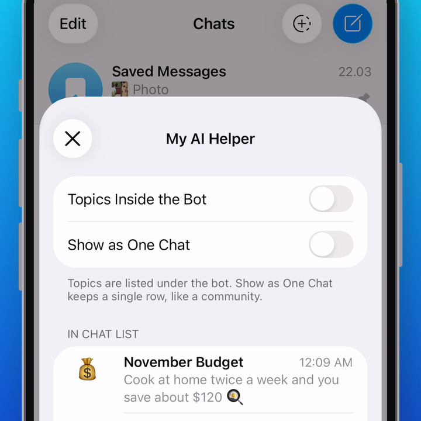

# Redesigned Threaded Mode

A concept for Telegram iOS by [@wayanyway](https://t.me/wayanyway), built on Telegram-iOS 13.1.1.



▶️ [Watch the demo](docs/threaded-mode/demo.mp4)

## What it does

Each topic of a bot with Threaded Mode becomes its own row in the chat list, right under the bot.
You see every conversation with the bot at a glance and open it in one tap, without going into the bot first.

Tap the arrow on the bot's avatar to choose how it looks, the same way as for communities:

- **Topics Inside the Bot.** The classic way: one row for the bot, the topic switcher inside the chat.
- **Show as One Chat.** One row with a stack, like a community. Tap it to see all topics.
- **In Chat List / Other Topics.** Long press a topic on that screen to hide it from the list or bring it back.
  New topics show up in the list by default.

These settings are kept per account.

It follows the bot's settings in @BotFather:

- **Threaded Mode off.** A regular chat with the bot, nothing changes.
- **Threaded Mode on.** Every new message starts its own topic, and it appears under the bot in the list.
  A **New Chat** button shows up on the bot's row: name the topic, pick an icon, and you're in.
- **"Disallow users to create new threads" on.** New Chat disappears and your messages stay in the main chat.
  Topics you already have stay under the bot, so you can keep talking both in the main chat and inside each topic.

Works in every chat list: All Chats, folders, archive.

## Try it

1. Build the app (see the guide below).
2. In @BotFather → your bot → Bot Settings, turn on Threaded Mode.
3. Open the chat list: the bot's topics are under it, New Chat is on its row.
4. Tap the arrow on the bot's avatar to switch how its topics look.

## Where the code is

| File | What changed |
|---|---|
| `ChatListUI/Sources/Node/ChatListNodeLocation.swift` | puts each bot's topics under the bot in the list |
| `ChatListUI/Sources/Node/ChatListItem.swift` | the session row: indent, topic icon, New Chat button; the arrow and the stack on the bot's avatar |
| `ChatListUI/Sources/Node/ChatListNodeEntries.swift` | the bot's row is redrawn when Show as One Chat changes |
| `ChatListUI/Sources/ChatListController.swift` | New Chat opens the native new-topic window |
| `TelegramUI/Sources/ChatInterfaceTitlePanelNodes.swift` | no topic switcher in a Threaded Mode bot's chat, unless Topics Inside the Bot is on |
| `TelegramUI/Components/ThreadedBotSessions` | which bots have sessions, their settings for the account, re-reading their topics |
| `TelegramUIPreferences/Sources/ThreadedBotSettings.swift` | per-bot settings kept in the account: topics inside, one chat, topics taken off the list |
| `TelegramUI/Components/Communities/CommunityViewScreen/Sources/CommunityViewScreen.swift` | the community screen shows a bot's topics and its settings |
| `TelegramCore/Sources/ForumChannels.swift` | re-reads a bot's topics: the server knows when a topic was read on another device, but doesn't tell this one |

All changes: [`main...threaded-redesign`](../../compare/main...threaded-redesign)

## Not done yet

- Swipe actions on a session row.
- Search on the bot's screen.

---

# Telegram iOS Source Code Compilation Guide

We welcome all developers to use our API and source code to create applications on our platform.
There are several things we require from **all developers** for the moment.

# Creating your Telegram Application

1. [**Obtain your own api_id**](https://core.telegram.org/api/obtaining_api_id) for your application.
2. Please **do not** use the name Telegram for your app — or make sure your users understand that it is unofficial.
3. Kindly **do not** use our standard logo (white paper plane in a blue circle) as your app's logo.
3. Please study our [**security guidelines**](https://core.telegram.org/mtproto/security_guidelines) and take good care of your users' data and privacy.
4. Please remember to publish **your** code too in order to comply with the licences.

# Quick Compilation Guide

## Get the Code

```
git clone --recursive -j8 https://github.com/TelegramMessenger/Telegram-iOS.git
```

## Setup Xcode

Install Xcode (directly from https://developer.apple.com/download/applications or using the App Store).

## Adjust Configuration

1. Generate a random identifier:
```
openssl rand -hex 8
```
2. Create a new Xcode project. Use `Telegram` as the Product Name. Use `org.{identifier from step 1}` as the Organization Identifier.
3. Open `Keychain Access` and navigate to `Certificates`. Locate `Apple Development: your@email.address (XXXXXXXXXX)` and double tap the certificate. Under `Details`, locate `Organizational Unit`. This is the Team ID.
4. Edit `build-system/template_minimal_development_configuration.json`. Use data from the previous steps.

## Generate an Xcode project

```
python3 build-system/Make/Make.py \
    --cacheDir="$HOME/telegram-bazel-cache" \
    generateProject \
    --configurationPath=build-system/template_minimal_development_configuration.json \
    --xcodeManagedCodesigning
```

# Advanced Compilation Guide

## Xcode

1. Copy and edit `build-system/appstore-configuration.json`.
2. Copy `build-system/fake-codesigning`. Create and download provisioning profiles, using the `profiles` folder as a reference for the entitlements.
3. Generate an Xcode project:
```
python3 build-system/Make/Make.py \
    --cacheDir="$HOME/telegram-bazel-cache" \
    generateProject \
    --configurationPath=configuration_from_step_1.json \
    --codesigningInformationPath=directory_from_step_2
```

## IPA

1. Repeat the steps from the previous section. Use distribution provisioning profiles.
2. Run:
```
python3 build-system/Make/Make.py \
    --cacheDir="$HOME/telegram-bazel-cache" \
    build \
    --configurationPath=...see previous section... \
    --codesigningInformationPath=...see previous section... \
    --buildNumber=100001 \
    --configuration=release_arm64
```

# FAQ

## Xcode is stuck at "build-request.json not updated yet"

Occasionally, you might observe the following message in your build log:
```
"/Users/xxx/Library/Developer/Xcode/DerivedData/Telegram-xxx/Build/Intermediates.noindex/XCBuildData/xxx.xcbuilddata/build-request.json" not updated yet, waiting...
```

Should this occur, simply cancel the ongoing build and initiate a new one.

## Telegram_xcodeproj: no such package 

Following a system restart, the auto-generated Xcode project might encounter a build failure accompanied by this error:
```
ERROR: Skipping '@rules_xcodeproj_generated//generator/Telegram/Telegram_xcodeproj:Telegram_xcodeproj': no such package '@rules_xcodeproj_generated//generator/Telegram/Telegram_xcodeproj': BUILD file not found in directory 'generator/Telegram/Telegram_xcodeproj' of external repository @rules_xcodeproj_generated. Add a BUILD file to a directory to mark it as a package.
```

If you encounter this issue, re-run the project generation steps in the README.


# Tips

## Codesigning is not required for simulator-only builds

Add `--disableProvisioningProfiles`:
```
python3 build-system/Make/Make.py \
    --cacheDir="$HOME/telegram-bazel-cache" \
    generateProject \
    --configurationPath=path-to-configuration.json \
    --codesigningInformationPath=path-to-provisioning-data \
    --disableProvisioningProfiles
```

## Versions

Each release is built using a specific Xcode version (see `versions.json`). The helper script checks the versions of the installed software and reports an error if they don't match the ones specified in `versions.json`. It is possible to bypass these checks:

```
python3 build-system/Make/Make.py --overrideXcodeVersion build ... # Don't check the version of Xcode
```
